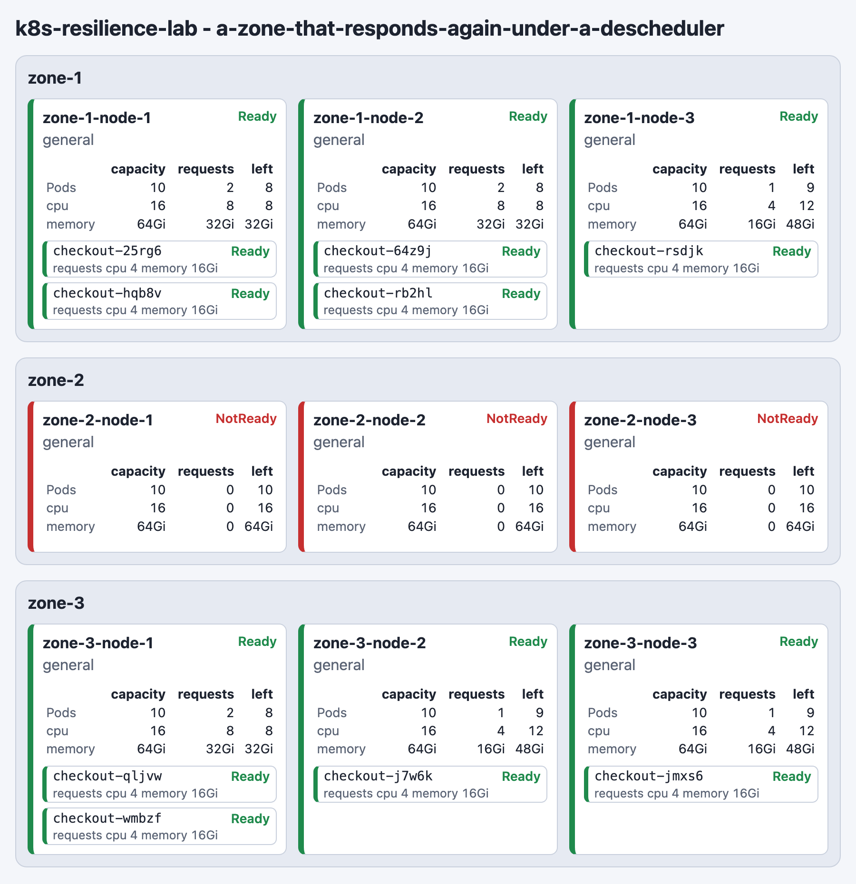

<a href="https://github.com/woditschka/k8s-resilience-lab/actions/workflows/checks.yml?query=branch%3Amain+event%3Apush"></a>

# k8s-resilience-lab

*Prove where your Pods land before the outage does.*

Declare a Topology of Zones and Nodes, and a Deployment under the spread rules and tolerations its manifest would carry. Stop a Node or a whole Zone, and assert the Placement the Kubernetes control plane reaches. Each experiment is a Scenario, a short Go function. It runs on a Simulated Cluster of its own, a real control plane over fake Nodes and Pods, so a run costs seconds and needs only a container engine.

**Seen, not claimed:** the lab's seven [Scenarios](scenarios/scenarios.go) run at once on seven clusters, and the whole command suite finishes in about a minute on a laptop. They judge Placement under a lost Node, a lost Zone, lost spot capacity and a tainted GPU pool.

> **TL;DR** — Whether spread constraints, anti-affinity and tolerations produce the intended Placement, and whether it recovers after a Zone or Node is lost, is normally discovered during a real outage. A cluster per developer is expensive, and a hand-written scheduler simulation proves nothing. This lab runs the genuine control plane against fake machines, writes each experiment as one readable Scenario, and leaves a Timeline explaining what the scheduler did and why.

## What It Looks Like in Practice

Every Scenario is a Go function in [scenarios/scenarios.go](scenarios/scenarios.go), one Step per line. This is the one that stops a Node:

```go
// Capacity comes back after one Node stops responding, on the Nodes still
// responding.
func ANodeThatStopsResponding_ShouldLeaveThePodsOnTheNodesStillResponding(s *lab.Scenario) {
	s.Given().Zones(3, node.Pool("general", node.PerZone(3), StandardNode()))
	s.WaitFor().AllNodesReady()
	s.Given().Deployment(Checkout, 9, StandardPod(), ResilientPlacement()).
		SurvivesLosing(lab.Nodes(1))
	s.WaitFor().AllPodsReady()

	s.Then().PodsPerZone(3)

	s.When().NodesFail(1)
	s.WaitFor().AllPodsReadyWithinSeconds(30)

	s.Then().PodsPerZone(3)
	s.Then().NoPodsOnTheFailedNodes()
	s.Then().EnoughPodsStayedReady()
}
```

A Scenario reads like a test without the `Test` prefix. A Given declares and reaches no cluster. A Wait applies what the Givens declared and holds until the cluster reports the state it names. A When injects the Failure. A Then judges the Placement the last Wait reached, and a Then the Placement does not meet records a Finding while the later Steps still run.

The Scenario's name is the condition half of its function's name, so this one runs as `a-node-that-stops-responding`. Adding a Scenario is a function in that file and one line in `All`. The vocabulary a Scenario writes, every Step and setting, is documented in [scenarios/README.md](scenarios/README.md).

A run reports every Scenario under its name and the Simulated Cluster it ran on, one line per Step. A Wait names the time it took, and a Then names what it judged. Under every Wait stands its Wait narrative: the moments since the previous Wait that changed the Placement. Behind a separator follows its Placement board: every Node under its Zone with the Pods on it. A `+` marks a Pod new on that Node, and a second separator closes the board before the Thens. A Skew line and the line naming the filed Timeline close the Scenario, and a heavier rule of `=` divides one Scenario from the next. The report of the Scenario `a-node-that-stops-responding` follows, abridged. The run's opening lines, the Topology's Given and Wait and the setting lines are left out, and a `...` line stands for further lines of the same kind. Every line the report may print is documented in [scenarios/README.md](scenarios/README.md).

```text
======================================================================================================================================
Scenario a-node-that-stops-responding, on k8s-resilience-lab-a-node-that-stops-responding-b7pzswsf
  Given a Deployment checkout of 9 replicas declaring Resilient placement, each Pod starting in 500ms to 1s, surviving the loss of 1 Node
  Wait for all Pods Ready, reached in 2.2s
  +8.223s  Pod checkout-5llj7 scheduled on zone-1-node-1, Running at +9.084s
  +8.224s  Pod checkout-xdtwv scheduled on zone-2-node-1, Running at +8.800s
  ...
  --------------------------------------------------------------------------
  zone-1
    zone-1-node-1  general  +checkout-5llj7
  ...
  --------------------------------------------------------------------------
  Then 3 Pods per Zone
  When 1 Node fails, zone-1-node-1
  Wait for all Pods Ready, reached in 7.4s of the 30s stated
  +10.421s  Node zone-1-node-1 NotReady
  +15.834s  Pod checkout-5llj7 evicted from zone-1-node-1
  +15.838s  Pod checkout-p9ddt scheduled on zone-1-node-2, Running at +16.818s
  ----------------------------------------------------------------------------
  zone-1
    zone-1-node-1  general
    zone-1-node-2  general  checkout-5xfkb, +checkout-p9ddt
    zone-1-node-3  general  checkout-4jsxj
  zone-2
    zone-2-node-1  general  checkout-xdtwv
    zone-2-node-2  general  checkout-mln4h
    zone-2-node-3  general  checkout-dsmf2
  zone-3
    zone-3-node-1  general  checkout-8b9b7
    zone-3-node-2  general  checkout-gwslt
    zone-3-node-3  general  checkout-hq4q5
  ----------------------------------------------------------------------------
  Then 3 Pods per Zone
  Then no Pod on the Nodes that failed
  Then enough Pods stayed Ready from the first Failure
    checkout kept its Floor of 8 Ready Pods through the loss of 1 Node: lowest 8 of 9 at +10.405s for 6.413s
  Skew of checkout: 0 over Zones, 1 over Nodes
  --------------------------------------------------------------------------------------------------------
  Timeline, 189 entries, filed at timelines/k8s-resilience-lab-a-node-that-stops-responding-b7pzswsf.jsonl
```

The narrative states an eviction and the replacement scheduled after it in order, and claims no link between them.

## Try a Failure by Hand

A Scenario answers a question you already wrote down. An Interactive run is for the questions you have not written yet. It holds one Scenario's Simulated Cluster and shows it in a browser, the Live view. Click a Node, a Zone or a Pod there to inject a Failure, and watch where the control plane places the Pods. What surprises you there is the next Scenario to write.

```bash
make demo                                # hold the Descheduler Scenario's cluster and open its Live view
make interactive SCENARIO=a-node-that-stops-responding  # hold another Scenario's cluster, and open the address yourself
```

Below, one click on zone-2 stopped its three Nodes. Their Pods were evicted, and the replacements landed on Nodes of zone-1 and zone-3.



The terminal reports the click as a When, then names each moment that changed the Placement:

```text
  When Zone zone-2 stops responding
  +29.580s  Node zone-2-node-2 NotReady
  +29.581s  Node zone-2-node-3 NotReady
  +29.582s  Node zone-2-node-1 NotReady
  +34.302s  Pod checkout-xs7xn evicted from zone-2-node-1
  +34.399s  Pod checkout-fs929 evicted from zone-2-node-3
  +34.502s  Pod checkout-svqkk evicted from zone-2-node-2
  +34.404s  Pod checkout-qljvw scheduled on zone-3-node-1, Running at +35.247s
  +34.311s  Pod checkout-25rg6 scheduled on zone-1-node-1, Running at +35.301s
  +34.507s  Pod checkout-rb2hl scheduled on zone-1-node-2, Running at +35.505s
```

Click zone-2 again and it responds again. The Descheduler then evicts one Pod on each pass until the three Zones hold three Pods each.

An Interactive run carries out its Scenario's Steps up to the first When, then names the Live view's address on `127.0.0.1`. Click a stopped Node or Zone to make it respond again; a lost Pod has no recovery. A click the lab cannot carry out prints a "Not injected:" line naming why. Ctrl-C files the Timeline and removes the Simulated Cluster. The [requirements](docs/prd.md#injecting-a-failure-from-the-live-view) list every case.

## Quick Start

Needed once: Go at the version in the Toolchain table of [CLAUDE.md](CLAUDE.md), and a container engine reachable over a Unix socket, such as Docker Desktop or Rancher Desktop. The lab probes the usual socket paths and honours a `unix://` `DOCKER_HOST`.

```bash
git clone https://github.com/woditschka/k8s-resilience-lab.git
cd k8s-resilience-lab

make run                                 # every Scenario, each on a Simulated Cluster of its own
make run ARGS="a-node-that-stops-responding"  # one Scenario alone, reported as a full run reports it
make run ARGS="--whole-timeline"         # print every Timeline entry under each filing line
make run ARGS="--k8s-version <version>"  # mirror another patch of the pinned Kubernetes minor
make interactive SCENARIO=a-node-that-stops-responding  # hold one Scenario's cluster and watch it live
make demo                                # the same, for the Descheduler Scenario, with the Live view opened in your browser
make test-unit                           # the lab's tests needing no container engine
make test-integration                    # the lab's tests needing one, each starting Simulated Clusters
make ci                                  # the full quality gate, both kinds of test and the Scenarios included
make vuln-check                          # scan the code the lab calls for known vulnerabilities (needs the network; the workflow runs it, the gate does not)
```

All Scenarios run at once, so a run lasts about as long as its slowest Scenario, and each reports as the section What It Looks Like in Practice shows. Stopping a run with Ctrl-C ends each Scenario still running part-way, naming the stop, and removes its Simulated Clusters. A second Ctrl-C ends the run at once and leaves the clusters not yet removed, as killing it does: `docker ps -a --filter name=k8s-resilience-lab` lists them and `docker rm -f` removes them.

`--k8s-version` names the Kubernetes version every Simulated Cluster mirrors, the lab's pinned default when absent. A run of every Scenario carries those declaring a Descheduler policy, so on a minor the lab pairs no Descheduler with it stops before provisioning, naming that version. The pinned default's minor has one. An Interactive run of a Scenario declaring no policy runs on any version, as in `make interactive SCENARIO=a-node-that-stops-responding ARGS="--k8s-version <version>"`.

The command suite runs every Scenario and fails when one reports a Finding or ends at a Step. The Scenarios are therefore the lab's own acceptance tests.

## Why This Exists

A team writes manifests that declare where its Pods may land: spread rules across Zones, anti-affinity between Nodes, tolerations for Nodes that stop responding. Whether those declarations hold, and whether the Placement recovers after a Zone or a Node is lost, is normally discovered during a real outage. Proving it earlier needs a cluster, and a cluster per developer and per build is expensive. A hand-written scheduler simulation is cheap but proves nothing, because every assertion then tests the simulation rather than Kubernetes.

The lab runs the genuine Kubernetes control plane against fake machines. Each Scenario gets a [KWOK](https://kwok.sigs.k8s.io/) cluster of its own in one container. That container runs the real control plane, with Nodes and Pods that exist only as API objects. Scheduling and controller behavior are therefore the real ones, nothing ever runs inside a Pod, and no image is pulled.

On that cluster a Scenario declares what a real team would declare, then watches what the control plane does:

- **A Topology** of Zones and NodePools, each NodePool stating how many Nodes it holds per Zone, their capacity, and the labels and taints its Nodes carry.
- **A Deployment** of a given replica count under a Pod specification: topology spread constraints, tolerations and resource requests under their Kubernetes names.
- **A Failure** that stops one Node, every Node of a Zone, or every Node of one label value. The lab withholds the Node's heartbeat, so the control plane marks it unresponsive and reschedules exactly as it would after a lost machine.
- **A Descheduler pass** under a policy the Scenario declares, run by the official Descheduler image beside the cluster once, or on each interval the Scenario states, which evicts the Pods the policy names so the control plane places them again. A Wait holds until a pass on the interval evicts nothing. The policy is written line for line like the YAML the Descheduler itself reads: the limits on the Pods a pass evicts per Node and in all, profiles, plugin configuration and the plugins each extension point enables.
- **Assertions** on the Placement once it has Settled: Pods per Zone, per Node and per NodePool, and the Floor of Ready Pods a Deployment keeps at every moment of the Failure, set by the Zones or Nodes its Failure tolerance survives losing.

Every Scenario also leaves a Timeline, recorded from the API's own watch streams, naming each Node, Pod and Deployment change, the scheduler's reason for each Placement, and each Step at its moment. A run narrates from it under every Wait and files it, so what happened inside the cluster is explainable afterwards.

The lab never touches a real cluster. It provisions and removes the Simulated Cluster it uses, reads no kubeconfig, and dials only a local engine socket. The reasons are recorded in [the non-goal ADR](docs/adr/2026-10-03-non-goal-real-cluster-runs.md).

## Under the Hood

The lab is one Go module built as a modulith. The `scenarios` package holds the experiments and nothing else. The machinery lives under `internal/`. `scenario` holds the immutable descriptions and does no I/O, and `cluster` holds every Kubernetes call. `lab` offers Scenarios their Steps, and `timeline` records what the cluster did. Kubernetes is a boundary the project does not control, so its types stay inside `cluster`, enforced by the compiler, by `internal/` and by a lint rule. New dependencies need a justification; the standard library comes first.

Every value a Scenario builds is immutable and validated by its own constructor, so a Topology or Deployment that cannot exist is refused at the line that declared it. A setting of several values is a keyed struct literal under Kubernetes' own field names, so a Scenario reads as its manifest would. Each exported name sits in the package of its subject, `pod`, `node`, `descheduler` or `lab`.

Testing follows the same stance of proving rather than simulating:

- **Tests are written first**, and a bug fix starts with a reproducing test.
- **No mocks.** Tests use real values and real I/O, and every cluster-backed test provisions a Simulated Cluster of its own, removed when the test ends however it ends.
- **A test that cannot confirm its outcome fails**, naming what it needed, such as a container engine. Nothing skips.
- **Waits are the lab's own.** A test holds on the cluster only through the lab's waits, never through a sleep or a polling loop of its own.
- **Tests are specifications**, named `<Condition>_Should<Outcome>` and structured as Arrange, Act, Assert, so a reader answers what world the test lives in, what it does and what should hold.
- **The pyramid holds.** Most tests are pure unit tests over the descriptions, and fewer run a real cluster. The command suite is the end-to-end layer, running every Scenario once.

The documents behind the code:

| Document | Holds |
|----------|-------|
| [docs/prd.md](docs/prd.md) | What the lab does and why, as tagged requirements |
| [docs/system-design.md](docs/system-design.md) | The current design: packages, contracts, state machine, threat model |
| [docs/adr/](docs/adr/README.md) | The decision log: options considered and why each was chosen or set aside |
| [docs/architecture-principles.md](docs/architecture-principles.md) | Module boundaries, the domain core and the Go idioms the code follows |
| [docs/testing-principles.md](docs/testing-principles.md) | How tests are written, structured and named |
| [docs/security-principles.md](docs/security-principles.md) | The threat model's ground rules |
| [docs/ubiquitous-language.md](docs/ubiquitous-language.md) | The vocabulary every document and Scenario shares |
| [scenarios/README.md](scenarios/README.md) | Every Scenario and the Steps and settings one may write |
| [CLAUDE.md](CLAUDE.md) | The maintainer's guide: toolchain, build, conventions and the agent workflow |

## Disclaimer

This is a personal learning project. It documents patterns and ideas the author explored while studying how Kubernetes places and reschedules Pods, with AI coding agents doing much of the building.

Use anything here freely under the [MIT License](LICENSE), but at your own risk. The lab reasons about Placement on a Simulated Cluster; evaluate everything yourself before applying it to a cluster that carries real traffic.

This project is not affiliated with, endorsed by, or sponsored by the Kubernetes project, the Cloud Native Computing Foundation, the KWOK maintainers, Docker, SUSE, Anthropic, or any other vendor mentioned in this repository. All product names, trademarks, and registered trademarks are the property of their respective owners and are used here solely for identification and descriptive purposes.

## License

[MIT License](LICENSE)
